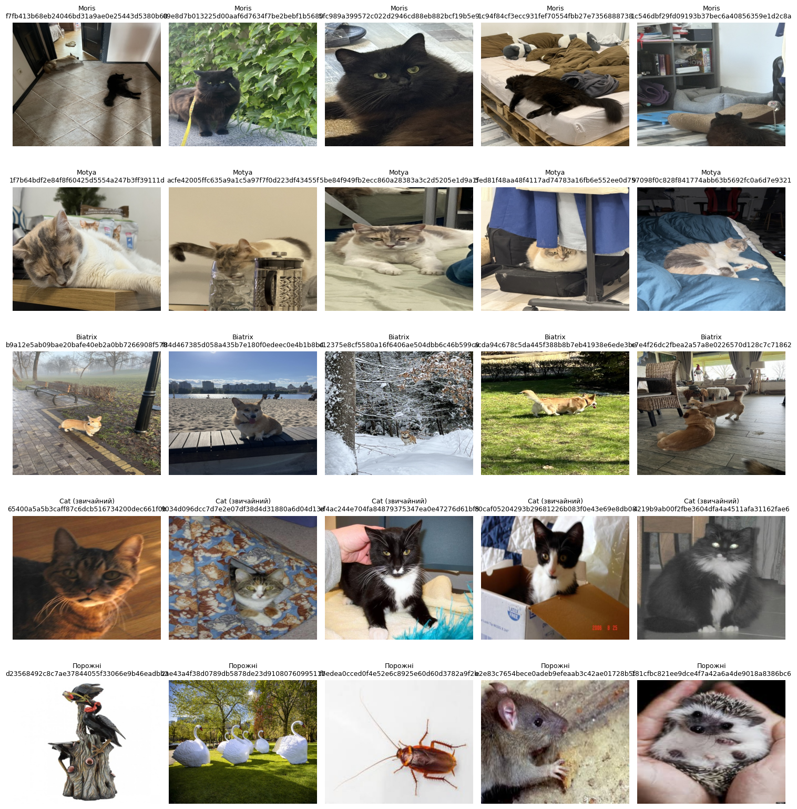
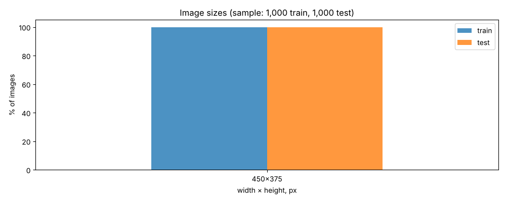
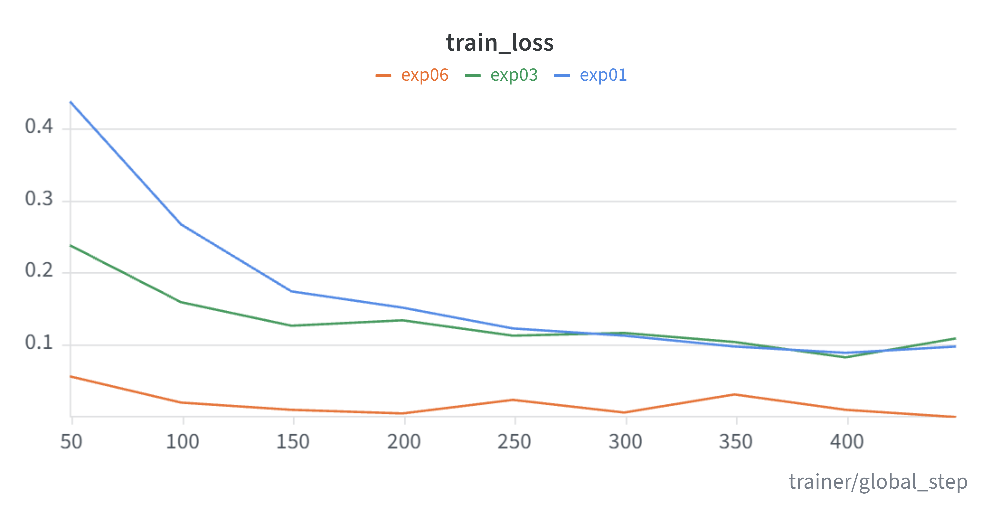
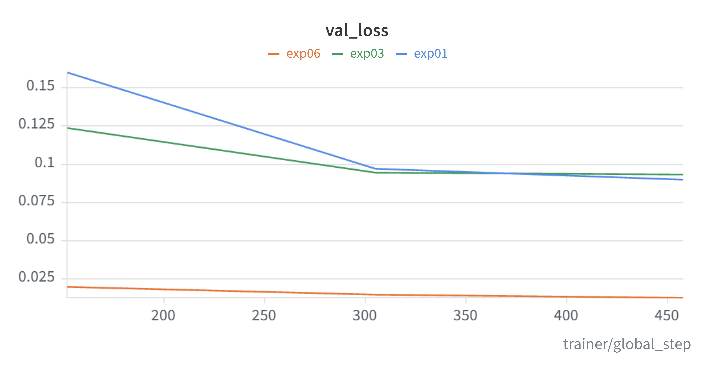
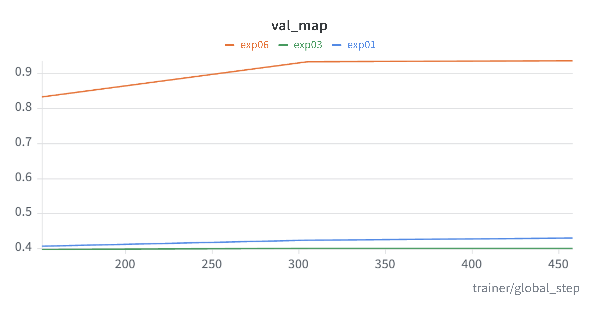
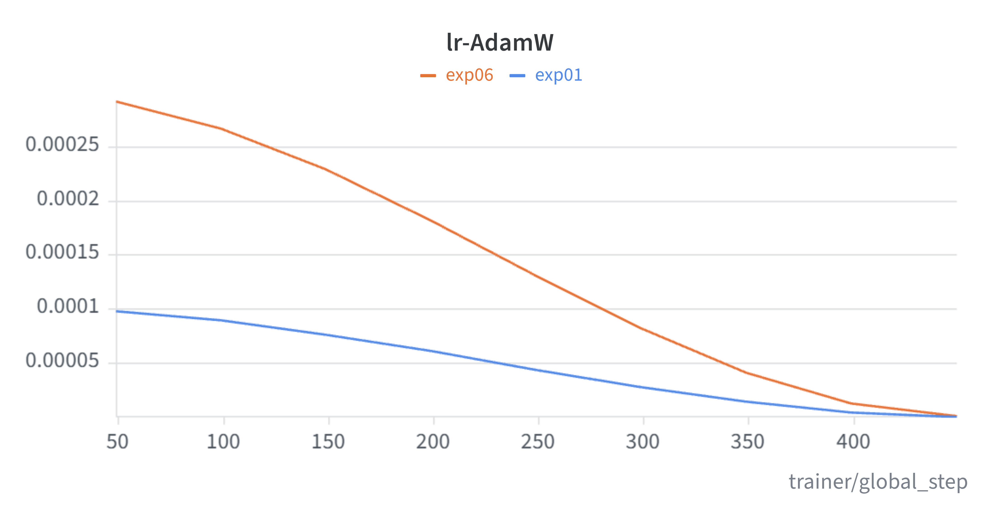
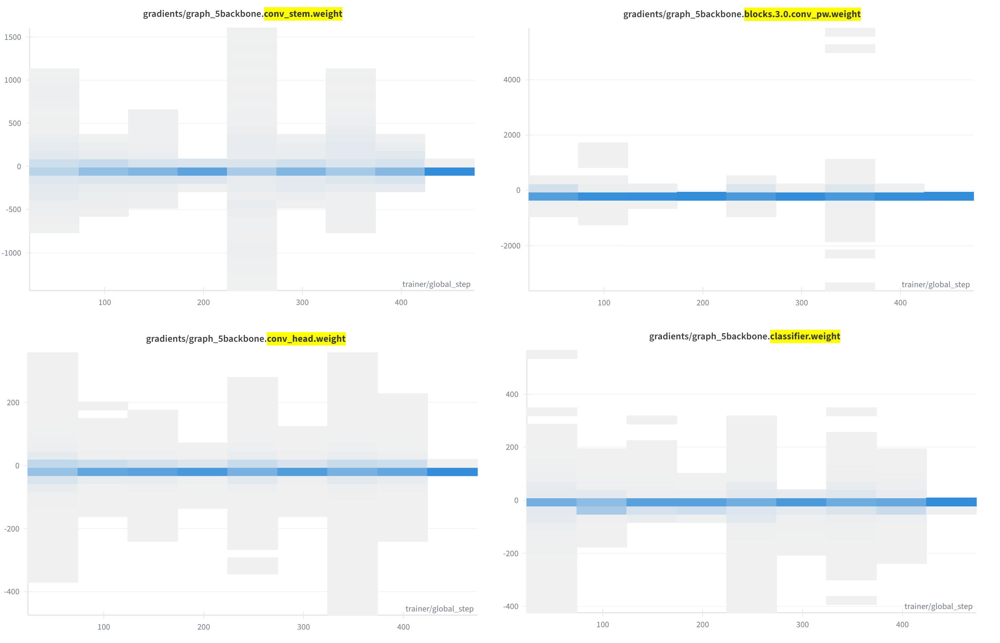
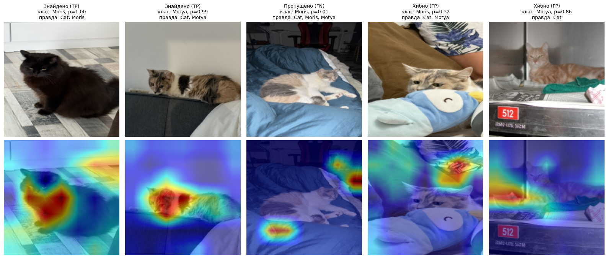
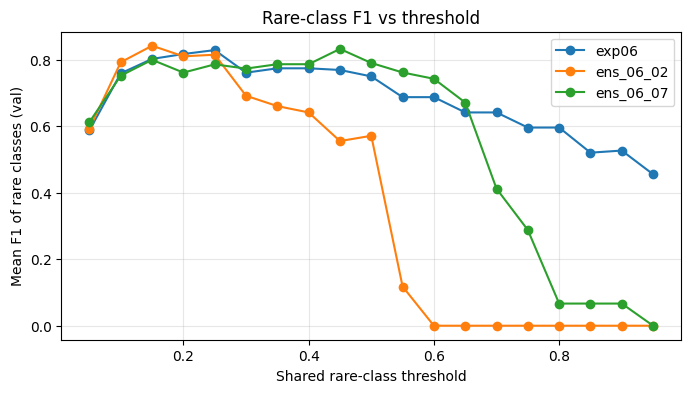
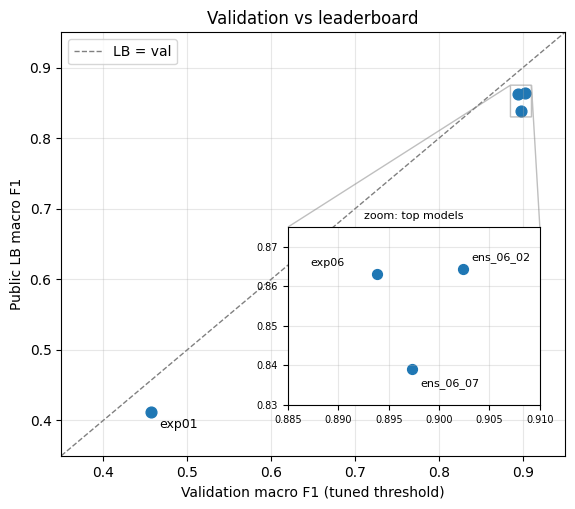

# Cats and Dogs++ — Multi-label Pet Classification
### Liliia Yaroshenko AI28

**Competition:** [Cats and Dogs++ on Kaggle](https://www.kaggle.com/competitions/cats-and-dogs/overview)

**Experiment tracking:** [W&B project `cats-and-dogs-pp`](https://wandb.ai/lyaroshenko-kse/cats-and-dogs-pp)

**Stack:** PyTorch, PyTorch Lightning, timm, torchvision, scikit-learn, Weights & Biases (no Keras / TensorFlow / Chainer).

**Final result:** single best model `exp06` (EfficientNet-B0) — validation macro F1 0.894, public LB 0.863. Final selected submissions: ensembles `ens_06_07` (best validation mAP) and `ens_06_02` (best validation F1, public LB 0.864).

---

## 1. Data (EDA)

The training set has **12,260 images**, each with five binary labels: two species (`Cat`, `Dog`) and three individual pets (`Moris`, `Motya`, `Biatrix`). It is a multi-label task: one photo can carry several labels.

### Class frequencies

| Class | Positives | Share |
|---|---:|---:|
| Cat | 5,077 | 41.41% |
| Dog | 5,025 | 40.99% |
| Moris | 56 | 0.46% |
| Motya | 42 | 0.34% |
| Biatrix | 41 | 0.33% |

### Labels per image

| Labels on image | Images | Share |
|---:|---:|---:|
| 0 | 2,162 | 17.63% |
| 1 | 9,973 | 81.35% |
| 2 | 111 | 0.91% |
| 3 | 10 | 0.08% |
| 4 | 4 | 0.03% |

### Co-occurrence matrix (diagonal = number of positives)

|  | Cat | Dog | Moris | Motya | Biatrix |
|---|---:|---:|---:|---:|---:|
| **Cat** | 5,077 | 4 | 56 | 42 | 4 |
| **Dog** | 4 | 5,025 | 4 | 0 | 41 |
| **Moris** | 56 | 4 | 56 | 10 | 4 |
| **Motya** | 42 | 0 | 10 | 42 | 0 |
| **Biatrix** | 4 | 41 | 4 | 0 | 41 |

**Hierarchy.** Every Moris and every Motya photo is labelled `Cat` (100%), and every Biatrix photo is labelled `Dog` (100%). The rare classes are therefore specific individuals nested inside the species classes. Photos with both a cat and a dog are almost absent: the only 4 such photos are the ones where Moris and Biatrix appear together. Moris and Motya appear together on 10 photos.

**Empty photos.** 17.6% of images have no label at all. They are not empty frames but distractors: other animals and objects such as birds, swan sculptures, insects, rats or hedgehogs. The model has to say "no cat, no dog" on them.

### Image grid

### Image sizes

A random sample of 1,000 train and 1,000 test images shows that **all images are 450×375 px** (aspect ratio 1.20), identically in train and test.

**Conclusion:** the data is extremely imbalanced. Cat and Dog cover ~41% each, while Moris, Motya and Biatrix have only 41–56 photos each (<0.5%). Under a macro-averaged metric these three rare classes decide 60% of the score, so the whole project is effectively about recognising three specific pets. Because all images share one size, resizing to 224 px only downsamples them and does not need to align different shapes.

---

## 2. Metric: Macro F1

**How it is computed.** For every class separately we compute F1, the harmonic mean of precision and recall: F1_c = 2·TP_c / (2·TP_c + FP_c + FN_c). The final score is the plain average of the five per-class values. Each class contributes exactly 1/5 of the score regardless of its size.

**Strengths.** Rare classes weigh as much as frequent ones: Motya (<0.5% of photos) counts as much as Cat (41%). A model cannot score well while ignoring Moris, Motya and Biatrix, which together determine 60% of the metric. F1 also penalises both misses (FN) and false alarms (FP), so always or never predicting a class does not pay off.

**Weaknesses.**
- *Threshold-dependent.* The model outputs probabilities, while F1 is computed on binary decisions, so the score depends heavily on where the decision boundary is placed.
- *Not directly optimisable.* F1 is not differentiable, so we train with BCE and only obtain F1 after choosing thresholds. The loss and the metric do not match.
- *Very noisy on rare classes.* Fold 0 contains only 9 Motya and 9 Biatrix photos. One missed Motya lowers the class F1 from 1.00 to 0.94 (−6 pp) and the overall macro F1 by ~1.2 pp. Differences of 1–2 pp between models can therefore be pure noise.

**Edge case.** If the model predicts no Motya at all (all probabilities below the threshold), then TP = 0 and F1_Motya = 0. The overall score loses up to 0.2 even if the other four classes are perfect. Models are usually uncertain on rare classes and rarely exceed 0.5, so the threshold for rare classes should be lower than 0.5 and tuned on validation. Our baseline hit exactly this case: at threshold 0.5 it predicted no rare animals at all.

**Additional metrics.** Per-class F1 and per-class Average Precision (AP), plus macro ROC AUC as an overall ranking-quality check.

**Model-selection metric: macro mAP.** Mean average precision over the five classes does not depend on the threshold, gives all classes equal weight, and is more stable on small samples: one mistake moves one position in the ranking instead of flipping a binary decision. We therefore pick the best model by **validation macro mAP** and tune the thresholds for the final macro F1 afterwards.

**Conclusion:** macro F1 forces the model to learn the rare classes, but it is threshold-dependent and very noisy with ~9 validation examples per rare class. We compare models by macro mAP and tune thresholds separately, with a lower threshold for the rare classes.

---

## 3. Validation

**Scheme.** 5 folds (`folds.csv`) of ~2,450 images each, built with three rules:

1. **Stratification by label combination.** Each image's labels are concatenated into a string such as `10100` (Cat + Moris), and `StratifiedGroupKFold(n_splits=5, shuffle=True, random_state=42)` uses it as `y`.
2. **Duplicate groups.** For each training image a perceptual hash (`imagehash.phash`) was computed. Images with an identical hash form one group. For the 125 photos of rare classes, hashes were also compared pairwise and pairs with Hamming distance ≤ 8 were merged into the same group. Result: 124 groups of exact duplicates (248 photos) and 3 near-duplicate pairs among rare photos; 12,134 groups in total, 252 photos have a "twin". A group never crosses fold boundaries.
3. **Manual placement of rare groups.** Plain `StratifiedGroupKFold` produced uneven rare-class counts (5 to 18 per fold), because it balances label combinations, which are dominated by thousands of cats, dogs and empty photos. Groups containing rare classes were therefore assigned greedily to the fold that brings the counts closest to the expected value, and the remaining groups were split by `StratifiedGroupKFold(random_state=42)`.

| Fold | Images | Cat | Dog | Moris | Motya | Biatrix | Empty |
|---:|---:|---:|---:|---:|---:|---:|---:|
| 0 | 2,450 | 1,017 | 998 | 12 | 9 | 9 | 437 |
| 1 | 2,451 | 1,032 | 995 | 11 | 9 | 8 | 424 |
| 2 | 2,459 | 1,004 | 1,000 | 11 | 8 | 8 | 456 |
| 3 | 2,444 | 1,019 | 1,024 | 11 | 8 | 8 | 402 |
| 4 | 2,456 | 1,005 | 1,008 | 11 | 8 | 8 | 443 |

Because of time limits, **all experiments use fold 0 as validation** (12 Moris, 9 Motya, 9 Biatrix), which keeps them comparable with each other.

**Why this scheme.**
- *Random, not time-based, split.* The test set is a random sample from the same distribution; there is no time factor.
- *Stratification.* With 41–56 photos per rare class, an unstratified split could give one fold 3 Motya and another 15, making the validation score depend on the luck of the split.
- *Groups.* The data contains series of near-identical frames, especially of the rare pets. If a near-copy of a Motya photo landed in both train and validation, the model would just "remember" the frame and the score would be inflated.

**Adversarial validation.** A ResNet-18 was trained to distinguish train from test images (3,000 + 3,000 images, 80/20 split, 2 epochs, same pipeline). ROC AUC on the held-out 20% is **0.487**, i.e. at chance level. Together with identical image sizes, this shows that train and test come from the same distribution.

**Why CV and LB can still differ.**
- *Few rare examples on both sides.* Both the validation fold (~9 per class) and the public test part contain only a handful of rare photos, so both estimates are noisy.
- *Thresholds tuned on a small sample.* Rare-class thresholds are fitted to 9–12 specific photos of fold 0, so the CV score is optimistic.
- *Train/test shift* is ruled out by adversarial validation (AUC 0.49).

**Conclusion:** validation on fold 0 with duplicate groups and stratification is honest and identical for all experiments, and adversarial validation (AUC 0.49) confirms that train and test match. Because there are only ~9 examples of each rare class, it is noisy, so small differences between models and CV/LB gaps should not be over-interpreted.

---

## 4. Preprocessing and augmentation ("feature engineering")

| Stage | Train | Validation / Test |
|---|---|---|
| Decode | PIL → RGB | PIL → RGB |
| Geometry | `RandomResizedCrop(224, scale=(0.5, 1.0))` | `Resize(224)` + `CenterCrop(224)` |
| Augmentation | `RandomHorizontalFlip()` | — |
| Normalisation | ImageNet mean/std | ImageNet mean/std |

- **Crop scale ≥ 0.5.** The default `RandomResizedCrop` can keep as little as 8% of the image and would often cut the pet out, which is fatal for the rare classes. Keeping at least half the image preserves the animal.
- **Deterministic evaluation.** Validation and test use resize plus centre crop without randomness, so results are reproducible.
- **Aspect ratio.** Images are 450×375 (1.20). Resizing the short side to 224 and centre-cropping trims ~20 px on each side instead of squashing the animal.
- **Label post-processing (domain knowledge).** After thresholding: if Moris or Motya = 1, then Cat = 1; if Biatrix = 1, then Dog = 1. It follows directly from the hierarchy found in EDA and is applied identically to validation and test.
- **Oversampling option.** `WeightedRandomSampler` with weight ×N for photos containing rare classes (tested in `exp05`).

**Conclusion:** augmentation is deliberately light and protects the rare animals from being cropped out, and the class hierarchy is enforced by post-processing rather than learned.

---

## 5. Experiments

Common setup unless stated otherwise: 224 px, batch 64, 3 epochs, `precision="16-mixed"`, `BCEWithLogitsLoss`, checkpoint with the best `val_map`, rare-class threshold tuned on fold 0 (one shared threshold for Moris/Motya/Biatrix, 0.5 for Cat/Dog). Each experiment changes **one** thing relative to the baseline `exp01`; `exp06` and `exp07` start from the best previous configuration.

| ID | Change | val mAP | AP Moris | AP Motya | AP Biatrix | F1 @0.5 | Rare thr. | F1 @thr. | LB |
|---|---|---:|---:|---:|---:|---:|---:|---:|---:|
| exp01 | Baseline: ResNet-18, AdamW, lr 1e-4, cosine | 0.429 | 0.089 | 0.021 | 0.049 | 0.382 | 0.20 | 0.457 | 0.413 |
| exp02 | lr 3e-4 | 0.652 | 0.616 | 0.235 | 0.413 | 0.392 | 0.10 | 0.615 | — |
| exp03 | SGD + momentum 0.9, lr 1e-2 | 0.400 | 0.011 | 0.004 | 0.012 | 0.378 | 0.05 | 0.376 | — |
| exp04 | OneCycle instead of cosine | 0.433 | 0.100 | 0.027 | 0.053 | 0.383 | 0.20 | 0.454 | — |
| exp05 | Oversampling of rare classes ×10 | 0.592 | 0.623 | 0.156 | 0.196 | 0.382 | 0.30 | 0.571 | — |
| **exp06** | **EfficientNet-B0 (settings of exp02)** | **0.936** | 0.906 | 0.876 | 0.900 | 0.846 | 0.25 | 0.894 | **0.863** |
| exp07 | Own block: GeM pooling + MLP head (base exp06) | 0.932 | 0.878 | 0.812 | 0.972 | 0.688 | 0.20 | 0.868 | — |

Cat and Dog AP is 0.99+ in every experiment, so all differences come from the rare classes.

**Per-experiment conclusions**
- **exp01 (baseline).** It separates cats and dogs almost perfectly (AP 0.99), but the rare classes stay close to chance (AP 0.02–0.09). At threshold 0.5 no rare animal is predicted at all (F1 = 0 for all three), so macro F1 is 0.38. A shared threshold of 0.20 lifts it to 0.46, and LB 0.413 confirms that the pipeline is correct.
- **exp02 (lr 3e-4).** Hypothesis confirmed: the baseline learns too slowly. With a 3× higher learning rate, Moris AP grows from 0.09 to 0.62 and val mAP from 0.43 to 0.65. The learning rate is the single most important hyperparameter among the ones tested.
- **exp03 (SGD).** Worst run: rare-class AP ~0.01, i.e. chance. In 3 epochs SGD with lr 1e-2 did not move the rare classes at all; AdamW is clearly better for short fine-tuning here.
- **exp04 (OneCycle).** Equal to the baseline (0.433 vs 0.429, within noise). OneCycle used the same maximum lr of 1e-4, so the schedule shape changed but the effective learning speed did not.
- **exp05 (oversampling ×10).** Hypothesis confirmed: seeing rare pets more often helps (0.59 vs 0.43). The gain is smaller than from raising the learning rate, and it was not tested in combination with lr 3e-4.
- **exp06 (EfficientNet-B0).** Largest improvement: val mAP 0.936 vs 0.652 for ResNet-18 with identical settings (`exp02`), so the fair comparison of architectures is exp06 vs exp02, not vs the baseline. LB 0.863.
- **exp07 (GeM + custom head).** Equal to the same model without the block (0.932 vs 0.936, within noise). It ranks Biatrix better (AP 0.97 vs 0.90) but Moris and Motya worse. The new randomly initialised head produces less confident probabilities: F1 at 0.5 is 0.69 vs 0.85, and the gap closes after threshold tuning.

This table, together with the W&B runs, serves as the parameter-tuning log (learning rate, optimiser, scheduler, sampling, architecture, head).

**Conclusion:** learning rate and architecture matter most: raising lr unlocked the rare classes and EfficientNet-B0 more than doubled their AP. SGD and OneCycle (at the same lr) brought nothing in a 3-epoch budget, and the custom GeM head matched the default one.

---

## 6. Final hyperparameters

**Best single model (`exp06`)**

| Parameter | Value |
|---|---|
| Architecture | `efficientnet_b0` (timm, ImageNet-pretrained, PyTorch weights) |
| Head | default timm head (global average pooling + linear, 5 outputs) |
| Input size | 224×224 |
| Loss | `BCEWithLogitsLoss` |
| Optimiser | AdamW, lr 3e-4, weight decay 1e-2 |
| Scheduler | cosine annealing per step, down to 0 |
| Epochs / batch | 3 / 64 |
| Precision | 16-bit mixed |
| Sampling | no oversampling |
| Checkpoint | best epoch by `val_map` |
| Thresholds | Cat 0.5, Dog 0.5, Moris / Motya / Biatrix 0.25 (shared) |
| Post-processing | Moris or Motya → Cat; Biatrix → Dog |

**Final selected submissions**

| Submission | Members | Rare threshold | Why selected |
|---|---|---:|---|
| `ens_06_07` | exp06 + exp07 | 0.45 | best validation mAP (main selection rule) |
| `ens_06_02` | exp06 + exp02 | 0.15 | best validation F1 |

Both selections are based on validation metrics, not on the public LB.

---

## 7. Diagnostics

### Learning curves (runs exp01 = baseline, exp06 = best, exp03 = worst)

- **No overfitting.** Validation loss decreases until the end in all three runs: exp06 0.020 → 0.013, exp01 0.16 → 0.090, exp03 0.12 → 0.093. In exp06 the train loss is lower than validation loss (~0.003–0.03 vs 0.013), but the gap is small and validation does not get worse. The spikes in exp06 train loss are noise from logging a single batch every 50 steps.
- **Were 3 epochs enough?** For exp06, yes: val mAP 0.83 → 0.934 → 0.936, a plateau after epoch 2. The plateau coincides with the cosine schedule taking lr to almost zero, so a longer schedule might still add a little. The baseline and SGD runs are under-trained: val mAP barely moves (0.41 → 0.43) or stays flat (~0.40).
- **Learning rate** follows the planned cosine decay from the initial value (3e-4, 1e-4, 1e-2) to zero.

### Gradient flow (exp06)

Histograms of four layers from input to output: `conv_stem.weight` (first convolution), `blocks.3.0.conv_pw.weight` (middle), `conv_head.weight` (last convolution), `classifier.weight` (output).

- **No vanishing gradients.** The spread in the first convolution (~±1000) is of the same order as in the middle (~±2000 with rare outliers) and at the output (~±400), so the signal reaches the first layers.
- **No exploding gradients.** The spread does not grow over training, and there are no empty panels or NaNs; occasional wide bins are single noisy batches.
- Towards the end, gradients narrow to zero in all layers, as loss and lr both decrease.
- *Caveat:* with 16-bit mixed precision W&B records gradients before loss-scaling is removed, so absolute values are inflated. Conclusions are drawn from comparing layers with each other.

### GradCAM (exp06, target layer `bn2`, last block)

Five validation photos: 2 correctly found (Moris p = 1.00, Motya p = 0.99), 1 missed Moris (p = 0.01), 2 false positives (Moris p = 0.32, Motya p = 0.86). At threshold 0.25 there was no missed Motya to show.

- **Correct predictions look at the animal:** Moris's body, Motya's head.
- **The missed Moris** is a hard frame: the black cat is barely visible in a dark corner, and the model's attention is in that dark area but its confidence is low. The issue is visibility, not background.
- **False positives look at the background:** a patterned fabric on one photo, and the edge of a cage and a towel on the other (a ginger cat, clearly not Motya). Possibly some Motya photos were taken in a similar setting; this is a hypothesis, not verified.

**Conclusion:** the best model learns on stable gradients without overfitting, and in correct predictions it attends to the animal itself. It still partly relies on the surroundings, which is typical when rare classes have few photos taken in the same rooms.

### Is the model adequate?

`exp06` reaches LB 0.863 against validation macro F1 0.894. The gap of 0.03 corresponds to 2–3 mistakes on rare classes, which is the noise expected with ~9 examples per class, and adversarial validation (AUC 0.49) rules out a train/test shift. Learning curves show no overfitting, gradients are stable, and GradCAM attends to the animal in correct predictions, so the model is adequate. Its weak spot is false positives driven partly by background.

---

## 8. Ensemble

Probabilities saved by each experiment were averaged (validation and test separately), and the shared rare-class threshold was tuned again on the averaged validation probabilities.

| Model | val mAP | val F1 @thr. | Rare thr. | LB |
|---|---:|---:|---:|---:|
| exp06: EfficientNet-B0 | 0.936 | 0.894 | 0.25 | 0.863 |
| exp07: EfficientNet-B0 + GeM head | 0.932 | 0.868 | 0.20 | — |
| exp02: ResNet-18 | 0.652 | 0.615 | 0.10 | — |
| ens_06_07: exp06 + exp07 | **0.973** | 0.897 | 0.45 | 0.839 |
| ens_06_02: exp06 + exp02 | 0.942 | **0.902** | 0.15 | **0.864** |
| ens_06_07_02: all three | 0.966 | 0.892 | 0.20 | — |

- **exp06 + exp07** clearly improves ranking (val mAP +0.036). The two EfficientNets are strong on different rare classes: exp06 on Moris and Motya, exp07 on Biatrix (ensemble AP: Moris 0.93, Motya 0.93, Biatrix 1.00 on 9 examples, which may be partly luck).
- **But F1 barely changes** (0.892–0.902 for all ensembles vs 0.894), a difference below one mistake on a rare class. A single shared threshold cannot fully exploit the better ranking.
- **On LB, `ens_06_07` is worse than `exp06`** (0.839 vs 0.863). The most likely reason is its threshold of 0.45, tuned on 9–12 rare photos. Different calibration of the two members also plays a role (the GeM head is less confident), and part of the 0.024 gap (~2 rare mistakes) may be noise.

The threshold curves support this explanation:
- For `ens_06_07` the curve is a **wide plateau**: mean rare-class F1 stays around 0.76–0.83 for every threshold from 0.10 to 0.60. The argmax at 0.45 (0.83) beats 0.15–0.25 (~0.79–0.80) by only ~0.03, i.e. one or two validation photos decided it. The chosen threshold is driven by noise, and a high value inside the plateau leaves less margin for test photos on which the model is less confident.
- `exp06` peaks at 0.20–0.25 and declines slowly, so its threshold transfers more safely.
- `ens_06_02` peaks at 0.15 and collapses above 0.5: averaging with the weaker ResNet-18 pulls rare-class probabilities down, which shifts the whole curve to the left. Its tuned threshold sits on the left side of that peak, which may be why it transferred well.
- **Adding the weak ResNet-18 did not hurt:** `ens_06_02` has the best validation F1 (0.902) and the best LB (0.864), but its lead over exp06 (0.001 on LB) is within noise.

**Conclusion:** ensembling two EfficientNets with different heads raised validation mAP from 0.936 to 0.973, but this did not translate into better F1, because the result is limited by a threshold tuned on very few rare examples. Better ranking does not guarantee a better F1 at one fixed threshold.

---

## 9. Validation vs leaderboard

| Submission | val F1 @thr. | Public LB | Gap |
|---|---:|---:|---:|
| exp01 | 0.457 | 0.413 | −0.044 |
| exp06 | 0.894 | 0.863 | −0.031 |
| ens_06_07 | 0.897 | 0.839 | −0.058 |
| ens_06_02 | 0.902 | 0.864 | −0.038 |

- **Large changes transfer.** The jump from the baseline to EfficientNet (+0.44 on validation) is matched on LB (+0.45), so validation reliably tells a weak model from a strong one.
- **LB is systematically 0.03–0.06 below validation.** This is expected: thresholds are tuned on the same fold 0 that is used for scoring, so validation F1 is optimistic.
- **Among the top models, the ordering is not preserved.** The three strong submissions differ by only 0.008 on validation, less than one rare-class mistake, so their order on LB is effectively random. The largest gap belongs to the submission with the highest tuned threshold (`ens_06_07`).
- *Limitation:* only 4 points. Other experiments were not submitted, so the correlation is shown on few submissions.

**Conclusion:** validation is trustworthy for large differences but cannot rank models that differ by less than ~0.02, and its systematic optimism comes from tuning thresholds on the evaluation fold itself.

---

## 10. Conclusions, limitations and next steps

**Conclusions**
- The task is a rare-class problem in disguise: Cat and Dog are solved by every model (AP 0.99+), and the score is decided by three individual pets with 41–56 photos each.
- The biggest gains came from a higher learning rate (rare-class AP 0.09 → 0.62) and a stronger architecture (EfficientNet-B0, val mAP 0.65 → 0.94). Oversampling helped moderately; SGD, OneCycle at the same lr, and the custom GeM head did not.
- The best single model reaches LB 0.863 (from a 0.413 baseline); the final selections are two ensembles (LB 0.839 and 0.864).
- Thresholds are the bottleneck: the ensemble with the best ranking lost on LB because its threshold was tuned on too few examples.

**Limitations**
- Only fold 0 was used: ~9 examples per rare class make every validation estimate noisy.
- Model selection (by mAP) and threshold tuning were done on the same fold, so validation F1 is optimistic.
- Short training (3 epochs) and small input size (224 px from 450×375 originals).
- GradCAM shows partial reliance on background in false positives.
- Only 4 LB points for the validation–LB analysis.

**What I would do next**
1. **Full 5-fold training** and averaging the five fold models, which also uses all rare photos for training.
2. **Thresholds on out-of-fold predictions:** tune them on ~41–56 examples per rare class instead of 9–12, possibly per class rather than shared.
3. **Larger images** (e.g. 384 px or the native 450×375) so that small or distant pets keep their details.
4. **Longer training** (8–15 epochs) with a longer cosine schedule, plus oversampling combined with the best learning rate.
5. **Stronger augmentation for rare classes** (colour jitter, random erasing) to reduce reliance on the background they were photographed in.
